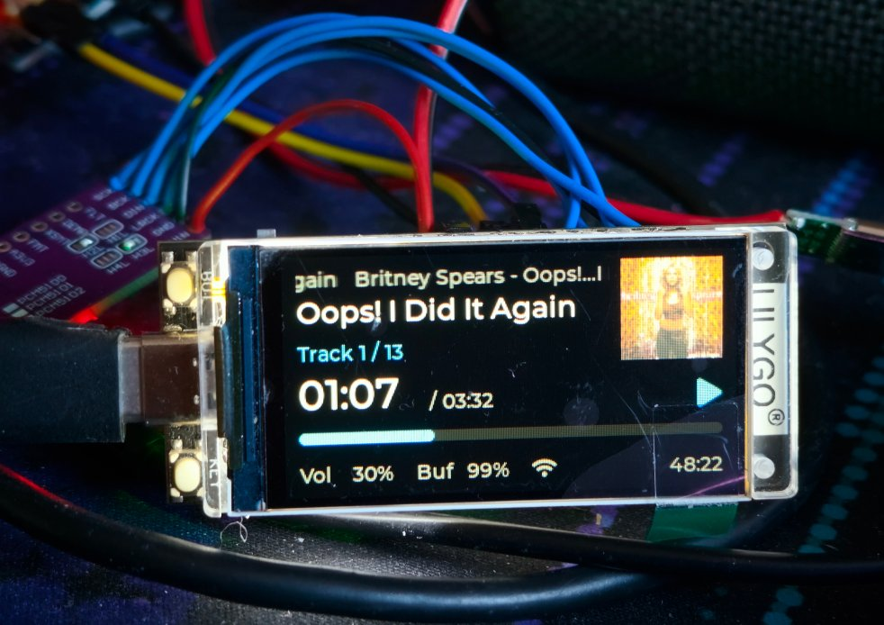
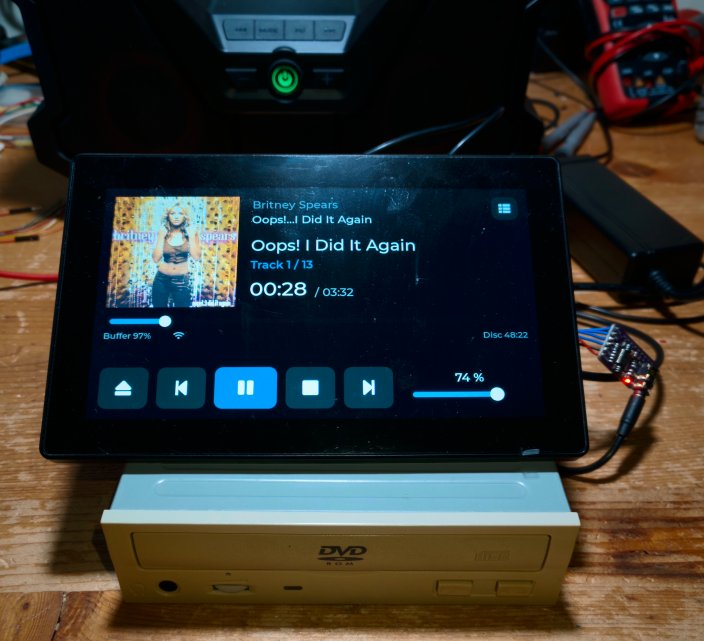
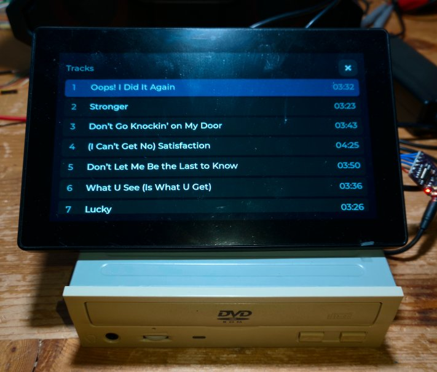
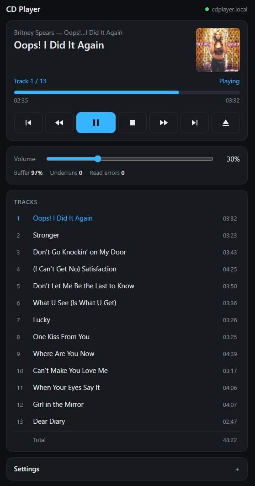
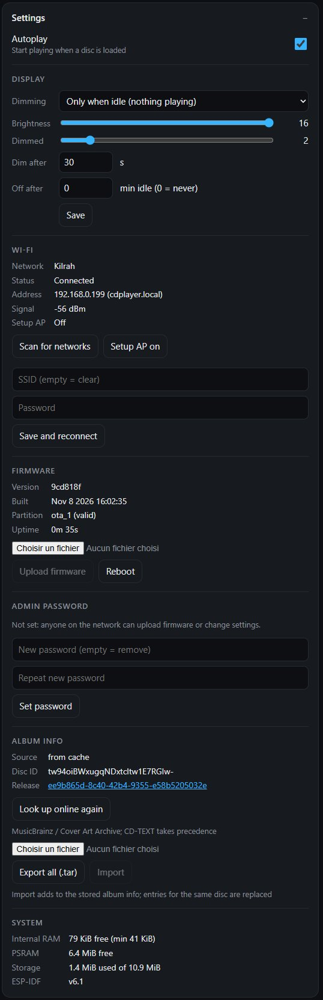

# ESP USB CD Player

An ESP-based standalone audio CD player. It reads audio CDs from a USB optical drive connected to the ESP's USB Host port, plays them through an I2S DAC, shows track info on a display and provides a webui for interaction. Hardware button controls not implemented yet.
USB ODDs are all either SATA or IDE behind a bridge anyway, so any existing IDE/SATA desktop/laptop drive should work behind an appropriate USB adapter.

Currently running on a LilyGO T-Display S3 with a PCM5102 DAC. Also runs on a Guition JC1060P470-V2 (ESP32-P4, 7" 1024x600 touch screen) with the same PCM5102 module, and headless (no display) on an Espressif ESP32-S31-Function-CoreBoard-1 (see [Boards](#boards)). It should be portable to any USB Host capable ESP (PSRAM is required, at least 2MB with current build).

Upon install a `CDPlayer-XXXX` access point, password `cdplayer` is opened for interaction/configuration/connecting it to your own network, where it will then be reachable through `http://cdplayer.local`. Hostname can be changed in settings.

CD-TEXT is displayed if available, and if internet is available disc metadata including cover will be retrieved from MusicBrainz / Cover Art Archive and cached locally in the LittleFS storage partition. 
A 1.5MB/~8s audio ring buffer is used to cover the case where playback is paused, the drive goes to idle and takes long to spin back up when resuming (more likely than using it while running these days...)











Video: 

[](https://youtu.be/6zRHcc-hUBA)

## Hardware notes:

Most ESP boards with USB Host support need modification, e.g.
- On the T-Display S3 where the USB port is normally used in "device" mode there is a diode that prevents an external supply from backfeeding into the host computer. That diode needs to be removed and replaced with a jumper for the USB port to provide power to the drive (and 5V supplied from board pads).
- On some Devkit-C-like boards with 2 ports the native USB port gets power from the USB-serial port, but through a fuse that causes too much voltage drop at the current a self-powered drive needs, so that also needs bypassing when using e.g. a laptop drive with no external power.
- Some drives are more suited than others. Some will ignore the speed command and spin at max speed playing audio CDs and be noisy as a result. Some have dynamic balancing that cause a "slipping" sound. Laptop drives are probably preferable.

# Agent details below

## Status

The project started from Espressif's USB Host MSC example with much Claude usage. The MSC driver has been replaced by our own [`esp_usb_host_atapi`](https://github.com/kilrah/esp_usb_host_atapi) driver, published as a separate component (pulled from GitHub by
the component manager).

| Area | State |
|---|---|
| Drive detection, INQUIRY, disc presence polling | Working: media events (GESN) when the drive reports them, else TEST UNIT READY. Tray locked while a disc is loaded (GESN drives), the eject button stops playback cleanly |
| TOC (track list, track types, pre-emphasis flag) | Working |
| CD-TEXT (album/track titles, artists, UPC, ISRC) | Working |
| Raw CD-DA audio reads (READ CD) | Working, ~3.8x realtime (~650 KiB/s) max; drive set to 4x |
| Eject / load, error recovery (STALL, timeouts, BOT reset) | Working |
| I2S output to PCM5102 | Working: gapless across tracks, 0 underruns in testing. Needs the module's solder bridges set (see below) |
| Transport: play/pause, stop, next/prev, seek, track select, volume | Working (web UI and serial commands; physical buttons to be added). Autoplay on disc load (setting); volume and autoplay persisted in NVS |
| Web UI (controls, track list, settings, firmware upload) at http://cdplayer.local/ | Working |
| Setup access point (no / unreachable Wi-Fi network) with captive portal | Working: AP, scan, web UI over the LAN tested; joining the AP from a phone not yet tested |
| Album info + cover art from MusicBrainz / Cover Art Archive (CD-TEXT discs: cover, text gaps), cached in LittleFS | Working (exact disc ID match, cover on screen and in the web UI, offline from cache) |
| Display UI (album/artist/title, track, time, progress, state, volume, buffer) | Working |
| Diagnostics (I2S pin frequency check, test tone, slow/failed read logging) | Working |
| De-emphasis for pre-emphasis tracks | Working: 1st-order IIR, max. 0.07 dB from the analog curve. Tested with serial `E` (forced), no pre-emphasis disc at hand |
| Non-ASCII text on screen (CD-TEXT, online album info) | Working: Latin-1 + Latin Extended-A + typographic punctuation (generated fonts, `tools/font_conv.ps1`); other scripts show as `?` |
| Wi-Fi (station, mDNS `cdplayer.local`, hostname settable in the web UI), firmware update over Wi-Fi (OTA) with rollback | Working: ~12 s per update (~120 KiB/s), slots alternate, new image confirms itself. Playback unaffected by Wi-Fi |
| Ethernet (boards that have it: ESP32-S31-Function-CoreBoard-1, JC1060P470), alongside Wi-Fi | Working: S31 at 1000 Mbps, JC1060P470 at 100 Mbps; DHCP, web UI and OTA over Ethernet, playback unaffected |
| Partition table: 2 × 2.5 MB OTA app slots + ~10.9 MB LittleFS at `/data` (for cached track lists / covers) | Working (album info cache in `/data/meta`). The app is ~1.6 MB |
| Power saving: drive spin-down after 2 min without playback; backlight dimming / off (web UI *Settings > Display*) | Working |
| Admin password for firmware upload and settings (HTTP Basic auth) | Working (optional, off by default) |

Verified with an **HP BD ROM BC-5501H** (slim SATA BD drive) behind an **Initio** USB bridge
(VID 0x13fd, PID 0x0840, interface subclass 0x02 / ATAPI, Bulk-Only), using a pressed audio CD with
CD-TEXT (Lorde, *Virgin*, 11 tracks). Also works with an old IDE drive, **JLMS XJ-HD165H**, behind a
**JMicron** USB-IDE bridge (VID 0x152d, PID 0x2338, subclass 0x06). This bridge needed exact READ TOC lengths (see the [driver README](https://github.com/kilrah/esp_usb_host_atapi#readme)).

## Hardware (current prototype)

**Board: LilyGO T-Display S3** (non-touch; ESP32-S3R8, 16 MB flash, 8 MB octal PSRAM, chip rev v0.2,
1.9" 320x170 ST7789 LCD on an 8-bit parallel bus). The board has no USB-serial converter, so an external FTDI
adapter is used for the console.

| Item | GPIO / detail |
|---|---|
| USB Host | Native USB-C connector (GPIO19/20), full speed only (12 Mbit/s). The drive is plugged in here |
| Console | External FTDI on **COM23**: board **TX = GPIO16**, **RX = GPIO21**, 115200 baud. The pin silkscreen is cut off and misleading (it looks like "1/2") |
| PCM5102 DAC | **LCK = GPIO43**, **DIN = GPIO44**, **BCK = GPIO18**, **SCK (MCLK) = GPIO17** |
| Onboard buttons | GPIO0 (BOOT) and GPIO14. Currently unused |
| LCD | ST7789 i80: D0-D7 = GPIO39-42, 45-48; WR 8, RD 9, DC 7, CS 6, RST 5, power 15, backlight 38 |
| Battery ADC | GPIO4 (not used) |
| Reserved pins | GPIO33-37 are used by the octal PSRAM |
| Flashing | **Only through the native USB port in download mode** (see below). The FTDI on GPIO16/21 cannot flash: the ROM bootloader only uses GPIO43/44 or native USB |
| Drive power | Needs a 5 V supply that can deliver the spin-up current. **Don't use a power bank**: power banks short the USB data lines to signal fast-charge capability, which breaks the connection to the drive |

GPIO43 is also the ROM's default UART TX, so the DAC's LCK line toggles briefly during boot. This is harmless.

Earlier prototype: an ESP32-S3 N16R8 devkit (UART console on COM22, WS2812 status LED on GPIO48). Its fuse on the
host connector's VBUS line dropped too much voltage and browned out the drive during spin-up; it had to be bypassed.
The WS2812 status LED code was removed when the display took over status indication.

## Boards

Each board has its own component in [components/](components) that provides the same `board.h`: display + LVGL
port (+ touch), backlight (0-16), I2S pins and an audio codec hook. A board without a display sets
`BOARD_HAS_DISPLAY 0`: `main` is then built without the UI and LVGL (decided by target in
[main/CMakeLists.txt](main/CMakeLists.txt)), the web status has no `display` object and the page hides its settings. The board is chosen by the IDF target
(component requirements can't depend on Kconfig), through a CMake preset ([CMakePresets.json](CMakePresets.json)):

| Preset | Target | Board | Build dir / sdkconfig | Screen layout |
|---|---|---|---|---|
| `default` | esp32s3 | LilyGO T-Display S3 ([components/tdisplay_s3](components/tdisplay_s3)) | `build/`, `sdkconfig` | small (320x170) |
| `p4` | esp32p4 | Guition JC1060P470 ([components/jc1060p470](components/jc1060p470)) | `build_p4/`, `sdkconfig.p4` | large (1024x600, touch) |
| `s31` | esp32s31 | ESP32-S31-Function-CoreBoard-1 ([components/s31_coreboard](components/s31_coreboard)) | `build_s31/`, `sdkconfig.s31` | none |

The screen layout is chosen by the display size, not the board ([main/ui_layout.h](main/ui_layout.h)): a new board
with a supported resolution only needs its board component. Settings shared by all boards are in
`sdkconfig.defaults`, board settings in `sdkconfig.defaults.<target>` (applied automatically). Each target has
its own component lock file (`dependencies.lock`, `dependencies.lock.esp32p4`, `dependencies.lock.esp32s31`). Everything in `components/` is
seen by the component manager for every target, so a board component's target-specific dependencies need a
`rules: - if: "target == ..."` entry.

### Guition JC1060P470 (ESP32-P4)

ESP32-P4 **rev 1.x** (v1.3, pre-production silicon; `CONFIG_ESP32P4_SELECTS_REV_LESS_V3`), 16 MB flash, 32 MB PSRAM,
7" 1024x600 MIPI-DSI panel (JD9165) with GT911 touch, ES8311 codec with an NS4150 speaker amplifier, ESP32-C6
for Wi-Fi (ESP-Hosted over SDIO). Same board as the `p4_edge_enhancer` project; the panel init sequence comes from there.

| Item | GPIO / detail |
|---|---|
| USB Host | The high-speed USB-OTG USB-C port (480 Mbit/s). The drive is plugged in here. Its VBUS comes from the board's 5 V rail (the other USB-C port or the battery booster): a bus-powered drive needs a strong supply there |
| Console | The other USB-C port ("USB1", USB-Serial-JTAG; COM13 on this PC), also used for cable flashing. Serial commands work on it as on the T-Display |
| Audio (default) | **PCM5102 module plugged 1:1 onto the VCC/GND/GPIO1-4 header**: VCC-VCC, GND-GND, GPIO1-LRCK, GPIO2-DIN, GPIO3-BCK, GPIO4-SCK (MCLK). Same module setup as on the T-Display (solder bridges). The speaker amplifier (GPIO11) is held off |
| Audio (option) | On-board ES8311 (I2C address 0x18): MCLK 13, BCLK 12, WS 10, DOUT 9; amplifier enable GPIO11; speaker connector. **Mono**: left and right are mixed. Select with menuconfig *Board: Guition JC1060P470 > Audio output* (`CONFIG_JC1060_AUDIO_ES8311`); OTA is enough |
| Display | MIPI-DSI 2 lanes, reset GPIO5, backlight PWM GPIO23 (LEDC, 16 levels, quadratic) |
| I2C | SDA 7, SCL 8: GT911 touch, ES8311 |
| Wi-Fi | ESP32-C6 on SDIO slot 1: CLK 18, CMD 19, D0-D3 14-17, C6 reset GPIO54 (esp_hosted defaults for the P4) |
| Ethernet | RMII, IC Plus **IP101GR** PHY at address 1 (ID 0243:0c54, logged at boot; IDF's generic 802.3 driver, 100 Mbps): MDC 31, MDIO 52, PHY reset 51, REF_CLK 50 (50 MHz input), TX_EN 49, TXD0/1 34/35, CRS_DV 28, RXD0/1 29/30 (the IDF defaults for the P4) |
| Battery sense | GPIO53 (68k/100k divider; not used) |

The first flash needs the cable:

```powershell
idf.py --preset p4 build
idf.py --preset p4 -p COM13 flash monitor
```

The C6 must run ESP-Hosted slave firmware compatible with the `esp_hosted` 3.x host. If Wi-Fi doesn't come up,
check the boot log for the hosted transport/version messages.

### Espressif ESP32-S31-Function-CoreBoard-1 (ESP32-S31)

A platform validation build, not meant for actual use. ESP32-S31-WROOM-3 (16 MB flash, 16 MB octal PSRAM at
200 MHz, CPU 320 MHz), native Wi-Fi 6, ES8311 codec with an NS4150B speaker amplifier, **no display**: the player
is driven from the web UI and serial commands. ESP32-S31 is a **preview target** in IDF 6.1. Pins from the
[schematic](https://dl.espressif.com/schematics/esp32-s31-function-coreboard-1-schematics.pdf).

| Item | GPIO / detail |
|---|---|
| USB Host | The USB-A port (USB 2.0 OTG **High-Speed**, UTMI PHY). VBUS through a TPS2051C switch, 500 mA limit: a bus-powered drive may need its own supply |
| Console | UART0 (GPIO58/59) through the on-board USB-UART bridge (the "UART" USB-C port, auto reset / download). The USB-Serial-JTAG USB-C port also flashes, but carries no console |
| Audio (default) | On-board ES8311 (I2C address 0x18): MCLK 52, BCLK (SCLK) 53, WS (LRCK) 55, DOUT (DSDIN) 56; amplifier enable GPIO57 (active high); speaker connector. **Mono**: left and right are mixed |
| Audio (option) | **PCM5102 module wired straight to the J2 header**: VCC, GND, GPIO25-LRCK, GPIO23-DIN, GPIO21-BCK, GPIO35-SCK (MCLK) (J2 pins 31/29/27/25). The amplifier is held off. Select with menuconfig *Board: ESP32-S31-Function-CoreBoard-1 > Audio output* (`CONFIG_S31CB_AUDIO_PCM5102`); OTA is enough |
| I2C | SCL 50, SDA 51: ES8311 |
| Ethernet | YT8531 gigabit PHY on RGMII ([espressif/yt8531](https://components.espressif.com/components/espressif/yt8531) driver): MDC 5, MDIO 6, PHY reset 7, TXD0-3 8-11, TX_CTL 12, TX_CLK 13, RX_CLK 14, RX_CTL 15, RXD3-0 16-19 (the IDF defaults for the S31). RGMII delays from Espressif's board definition (RX ~2 ns, TX 13 steps). The Tx clock comes from the **APLL** (`CONFIG_ETH_EMAC_RGMII_TX_CLK_SRC_APLL`): "Auto" picks the MPLL, which the 200 MHz PSRAM already runs at 400 MHz, and the EMAC init fails. I2S uses the XTAL on the S31, so the APLL is free |
| Other | BOOT button GPIO61, WS2812 LED GPIO60 (both unused) |

```powershell
idf.py --preset s31 build
idf.py --preset s31 -p <UART bridge port> flash monitor
```

## Building and flashing

Normally: **build and update over Wi-Fi** (see [Firmware update over Wi-Fi](#firmware-update-over-wi-fi-ota)).
A cable flash is only needed the first time, for bootloader or partition table changes, or to recover a device
that can't reach Wi-Fi.

ESP-IDF **v6.1** is installed with the Espressif Installation Manager (EIM).
`C:\esp\v6.1\esp-idf\export.ps1` does **not** work on this machine (it looks for a Python env that
doesn't exist). Activate the environment with the EIM profile script instead:

```powershell
. C:\Espressif\tools\Microsoft.v6.1.PowerShell_profile.ps1
idf.py build                 # T-Display S3 ("default" preset); --preset p4 for the JC1060P470, --preset s31 for the S31 board
idf.py -p COM17 flash        # native USB in download mode, see below
idf.py -p COM23 monitor      # logs + serial commands via the FTDI adapter
```

**Flashing the T-Display S3:** the running firmware uses the native USB port as USB Host, so no
serial port is exposed there. To flash:

1. Unplug the drive and connect the native USB-C port to the PC.
2. Hold **BOOT**, press and release **RST**, then release BOOT. The ROM's USB serial port appears
   (VID 0x303A, PID 0x1001; it was **COM17**).
3. Run `idf.py -p COM17 flash`.
4. **Press RST.** esptool's hard reset at the end of flashing did not reliably leave download mode, and the
   board stayed in the bootloader.
5. Reconnect the drive. Logs are on COM23.

A cable flash writes the bootloader, the partition table, the app into `ota_0`, and the initial otadata (so
`ota_0` boots, whichever slot ran before). NVS (volume, Wi-Fi credentials) and the LittleFS partition are not
erased. `idf.py erase-flash` erases both.

### Wi-Fi setup access point

Without a usable Wi-Fi network, the player opens its own access point so the web UI can be reached for setup
([main/net.c](main/net.c), [main/captive_dns.c](main/captive_dns.c)):

- **Ethernet** (boards with `BOARD_HAS_ETH`): an Ethernet address counts like a station connection. The AP
  only comes on while neither has an address; without Wi-Fi credentials it waits 10 s for Ethernet first, and
  an Ethernet connection switches it off after 30 s. Both interfaces can be up at once (same hostname, mDNS on
  both); Ethernet is the default route for outgoing traffic (MusicBrainz).

- **When:** right at boot if no network is configured. If a network is configured but not reachable
  for 30 s (at boot, or after the connection was lost), the AP starts too. The station keeps retrying in
  the background (AP+STA mode). It can also be switched on or off by hand: *Setup AP on/off* in the web UI, or
  `api/cmd?c=setup_ap&v=1/0`. Switched on by hand, it stays on until switched off or the next reboot.
- **Name / password:** `CDPlayer-XXXX` (last MAC bytes), WPA2 with `CONFIG_CD_AP_PASSWORD` (menuconfig
  *CD player*, default `cdplayer`; shorter than 8 characters = open network). The display's top line shows
  the network name and password, alternating every 3 s with the address, while the AP is on and there is no
  other connection.
- **Web UI at http://192.168.4.1/.** A captive-portal DNS answers every name with 192.168.4.1 (it is offered
  via DHCP on the AP only; the device's own lookups still go through the station), and unknown URLs redirect
  to the UI, so phones open the page by themselves after joining. The page shows a setup banner and opens the
  settings; *Scan for networks* lists nearby networks to pick from.
- **After setup:** once the station has an IP address, the page shows the new address, and the AP turns off
  30 s later.
- AP and station share the radio, and each connection attempt scans all channels, which disturbs AP
  clients. While someone is connected to the AP, attempts are limited to one per minute (except right after
  new credentials were saved).
- **Security:** the web UI has no login and accepts firmware uploads, so set your own AP password.

### Firmware update over Wi-Fi (OTA)

One-time setup: set the Wi-Fi credentials with the serial command `W`. It prompts for the SSID and password
(stored in NVS; an empty SSID clears them). Example from the agent shell:
`python tools/sercmd.py COM23 20 "0.5:W" "1:MyNetwork~" "2:secret~" "15:w"`.
Alternatively, set defaults in menuconfig (*CD player → Default Wi-Fi SSID/password*). Stored NVS credentials
take precedence. `w` prints the connection state, IP, firmware version, OTA state, storage and heap.

```powershell
idf.py build
python tools/ota.py                    # default host cdplayer.local, image build/usbhost_cd.bin
python tools/ota.py 192.168.1.42       # by IP if mDNS doesn't resolve
```

The device accepts the upload at `POST /ota` and checks that it is an ESP32-S3 app image of this project.
It writes the image to the inactive slot (`ota_0`/`ota_1`), sequentially erasing as data arrives, and then reboots.
Playback is paused during the upload, and the screen shows `Firmware update NN%`. `tools/ota.py` then polls
`GET /info` (JSON: version, build time, ELF SHA-256, partition, OTA state, uptime) until the device reports
the uploaded image's ELF SHA-256. The same works with
`curl --data-binary @build/usbhost_cd.bin http://cdplayer.local/ota`.

**Rollback:** `CONFIG_BOOTLOADER_APP_ROLLBACK_ENABLE`. A freshly updated firmware boots as *pending-verify*.
It confirms itself once it has connected to Wi-Fi and the HTTP server is running again, i.e. once the next OTA
update is possible. If it crashes or never gets there, the **next reset** boots the previous firmware. Note:
nothing resets the board automatically when the new firmware hangs; press RST or power-cycle. If no Wi-Fi
credentials are configured, the firmware confirms itself immediately.

**Admin password** ([main/auth.c](main/auth.c)): optional, set in the web UI (*Settings → Admin password*, stored in
NVS) or as a default in menuconfig (`CONFIG_CD_ADMIN_PASSWORD`). When set, firmware upload, Wi-Fi settings, reboot,
the setup AP switch, deleting a cache entry and changing the password need it (HTTP Basic auth, any user name;
the browser asks). Player controls stay open. `tools/ota.py` takes it from the environment variable
`CDPLAYER_PASSWORD`. The serial command `P` clears it (recovery with physical access). Note that a refused upload
is only answered after the whole image was sent (no `Expect: 100-continue` in the ESP HTTP server).

Dependencies (managed components): `espressif/usb` (USB Host library, external since IDF 6.0),
`espressif/esp_lvgl_port`, `lvgl/lvgl` (v9), `espressif/mdns`, `joltwallet/littlefs`.

### Partition table ([partitions.csv](partitions.csv), 16 MB flash)

| Name | Type | Offset | Size | Use |
|---|---|---|---|---|
| nvs | data/nvs | 0x9000 | 24 KB | Settings (volume, Wi-Fi credentials). |
| otadata | data/ota | 0xF000 | 8 KB | Which OTA slot boots, rollback state |
| phy_init | data/phy | 0x11000 | 4 KB | RF calibration data |
| ota_0 | app | 0x20000 | 2.5 MB | Firmware slot A |
| ota_1 | app | 0x2A0000 | 2.5 MB | Firmware slot B |
| storage | data/littlefs | 0x520000 | ~10.9 MB | LittleFS mounted at `/data` (`storage.c`). Formatted automatically on first mount. Meant for cached metadata from the internet (track lists, cover art) |

### Configuration (`sdkconfig.defaults`, `sdkconfig.defaults.esp32s3`)

- `CONFIG_USB_HOST_HUBS_SUPPORTED=y`: a powered USB hub can be placed between the board and the drive.
- 16 MB flash, octal PSRAM at 80 MHz. `malloc()` puts allocations of 4 KB or more in PSRAM (IDF default:
  16 KB). USB transfer buffers are allocated by the USB library from internal DMA-capable RAM.
- Wi-Fi IRAM optimizations off (`CONFIG_ESP_WIFI_IRAM_OPT`, `CONFIG_ESP_WIFI_RX_IRAM_OPT`): 18 KB more internal
  RAM; OTA throughput barely changed (124 vs 126 KiB/s).
- `CONFIG_FREERTOS_USE_TRACE_FACILITY=y` for the `m` serial command (heap and task stacks).
- Console on UART0, TX GPIO16 / RX GPIO21; no secondary console. The native USB port is the USB Host.
- LVGL: built-in Montserrat 14 (default font) and 28 (time, digits only); the text labels use the generated
  fonts in `main/fonts`. clib malloc/string/sprintf, so large LVGL allocations can go to PSRAM.
- The target comes from the CMake preset (`sdkconfig.defaults.<target>` pins it too), so `sdkconfig` can be
  regenerated from the defaults (delete it and build).
- Custom partition table (`partitions.csv`), app rollback enabled in the bootloader.
- Wi-Fi: `CONFIG_ESP_PHY_ENABLE_USB=y` keeps the USB PHY powered when the Wi-Fi PHY initializes. Without it the
  drive on the native USB port would stop working. Wi-Fi/lwIP buffers may be allocated in PSRAM.
  `CONFIG_MDNS_ENABLE_CONSOLE_CLI=n` (no console component in the build).
- QIO flash at 80 MHz (`CONFIG_ESPTOOLPY_FLASHMODE_QIO`). OTA refuses images with a different flash mode
  (`ESP_ERR_OTA_SPI_MODE_MISMATCH`), so changing it needs a cable flash (bootloader + app).

## Application

| File | Role |
|---|---|
| [main/cd_player_main.c](main/cd_player_main.c) | Drive connect/disconnect, disc polling every 1 s (GESN media events, or TEST UNIT READY), tray lock + eject button, TOC/CD-TEXT loading, eject/load, serial commands |
| [main/player.c](main/player.c) | Playback engine: a reader task fills 12 × 16-sector chunks (~2.5 s, 450 KB, `NUM_CHUNKS`) in PSRAM; a writer task streams them to I2S in 2-sector slices, applies the volume and tracks the position and the buffered sector count. A generation counter drops stale chunks on seek/stop/unload. Plays continuously across tracks, skips data tracks, stops at the lead-out. Reads are retried 3×; slow (>500 ms) and failed reads are logged |
| [main/player.h](main/player.h) | Player API, status snapshot, volume cap (persisted in NVS by `player.c`) (`PLAYER_VOLUME_MAX`, `PLAYER_VOLUME_STEP`, `player_volume_display()`) |
| [main/audio_out.c](main/audio_out.c) | I2S0 master, 44.1 kHz, 16-bit stereo, Philips format, MCLK = 256·fs. DMA auto-clear outputs silence on pause or underrun. Pin check and test-tone diagnostics |
| [main/fonts](main/fonts) | Text fonts for the display (Montserrat 14/20/28/40 px with Latin-1, Latin Extended-A, punctuation and the LVGL symbols), generated by [tools/font_conv.ps1](tools/font_conv.ps1). Fonts a layout doesn't use are dropped by the linker |
| [main/ui.c](main/ui.c) | Shared screen logic: display init, 200 ms refresh from a `player_get_status()` snapshot (runs in the LVGL task), backlight policy, cover image, text helpers |
| [main/ui_layout_small.c](main/ui_layout_small.c), [main/ui_layout_large.c](main/ui_layout_large.c) | Screen layouts by display size ([main/ui_layout.h](main/ui_layout.h)): 320x170 class, and 1024x600 class with touch controls |
| [main/net.c](main/net.c) | Wi-Fi station + Ethernet (board driver from `board_eth_init()`, DHCP, route priority above Wi-Fi): credentials from NVS (namespace `wifi`) or Kconfig, reconnect with backoff (1-30 s), no modem sleep, mDNS/DHCP hostname `cdplayer` (`CONFIG_CD_HOSTNAME`) unless one is set in the web UI (NVS namespace `net`, key `hostname`), starts the HTTP server on the first IP address |
| [main/ota.c](main/ota.c) | HTTP server: `GET /info`, `POST /ota` (streams into the next OTA slot, validates, reboots); confirms a pending-verify firmware |
| [main/storage.c](main/storage.c) | LittleFS on the `storage` partition at `/data` |
| [main/auth.c](main/auth.c) | Admin password (HTTP Basic auth) for firmware upload and settings |
| [main/captive_dns.c](main/captive_dns.c) | DNS server for the setup AP: every A query answered with 192.168.4.1 |
| [main/meta.c](main/meta.c) | Album metadata: cache lookup, MusicBrainz disc ID query, Cover Art Archive download, JPEG decode + scale for the screen (see below) |
| [main/discid.c](main/discid.c) | MusicBrainz disc ID (SHA-1 + base64 over the TOC; own SHA-1, since mbedTLS 4 doesn't export it) |
| [main/web.c](main/web.c), [main/web/index.html](main/web/index.html) | Web UI: the page plus a JSON API (`/api/...`) on the OTA HTTP server |
| [components/tdisplay_s3](components/tdisplay_s3) | ST7789 i80 + LVGL port setup, ported from [hiruna/esp-idf-t-display-s3](https://github.com/hiruna/esp-idf-t-display-s3) (MIT) to IDF 6 |
| [components/jc1060p470](components/jc1060p470) | JC1060P470: MIPI-DSI (JD9165) + LVGL port, GT911 touch, PWM backlight, ES8311 setup; pulls in ESP-Hosted / esp_wifi_remote for Wi-Fi |
| [components/s31_coreboard](components/s31_coreboard) | ESP32-S31-Function-CoreBoard-1 (no display): ES8311 setup and amplifier |

On disc load and after each spin-up the drive is set to 4x (`SET CD SPEED`) for less noise; the log line `Read speed ...` shows the result and the speed the drive reports. CD audio needs 1x. `SET STREAMING` (the MMC-3 alternative) is implemented but off by default: the TSSTcorp SH-S182M took it as "full speed". For trying other drives: `api/cmd?c=speed&v=<kB/s, 176 = 1x, 0 = max>&m=<1 SET CD SPEED, 2 SET STREAMING, 3 both>`, applied at once, not saved.
A disc starts playing as soon as it is loaded, whether inserted or already in the drive at power-up.
This is the *Autoplay* setting in the web UI (NVS namespace `player`, key `autoplay`, default on).

### Album info and cover art

When a disc is loaded ([main/meta.c](main/meta.c)):

1. The MusicBrainz disc ID is computed from the TOC. A trailing data track (Enhanced CD) is excluded and the
   lead-out moved to its start - 11400, like libdiscid.
2. The cache is checked: `/data/meta/<discid>.json` (album, artist, track titles/artists, release ID) and
   `<discid>.jpg` (the cover as downloaded). A hit is applied right away, without a network connection.
3. Otherwise, as soon as Wi-Fi is connected: `GET https://musicbrainz.org/ws/2/discid/<id>?toc=...`
   (the TOC enables fuzzy matching if the exact ID isn't known). The chosen release is the one that lists this
   disc ID, has front cover art, and has the same track count. Then the cover:
   `https://coverartarchive.org/release/<mbid>/front-250` (or the release group's), redirected to archive.org.
   The result is cached.
4. The player shows the data wherever CD-TEXT has nothing (CD-TEXT always wins, so for CD-TEXT discs this
   mostly adds the cover). The cover is decoded
   (`espressif/esp_jpeg`, 1/2 scale), center-cropped and area-averaged to the layout's cover size (72×72 small,
   300×300 large; the large layout downloads `front-500`).

Failures are retried after 5, 15, 60 and 180 s, then given up until the disc is reloaded. The reason of the last
failure is shown by `w` and in the web UI (Album info). A disc unknown to MusicBrainz is remembered until reboot, so it
isn't looked up again on every insert. Serial `M` or *Look up online again* in the web UI refreshes a cached
entry. While a lookup runs, a spinner turns in the cover area, on the display and in the web UI. The lookup typically
takes about 1 s for MusicBrainz and 5-20 s for the cover (archive.org is slow). It runs in its own task and
doesn't disturb playback.

**Export / import** (web UI, Album info): *Export all* downloads the whole cache as `cdplayer-meta.tar`
(`meta/<discid>.json` + `.jpg`), generated on the fly. That's about 1.2 MB for 38 discs and takes ~5 s. Windows
Explorer, 7-Zip and `tar` open it. *Import* takes such a tar: new entries are added, entries for the same disc
replaced, identical files left alone, and everything else in the cache kept. Only cache files are taken, from any
folder in the archive: `<28-character disc ID>.json` (a JSON object with that `discid`) and `.jpg` (a JPEG). Other
files are skipped, so an archive repacked from the extracted folder works too. Re-importing mostly identical data
takes ~6 s, but writing is slow (~30 KB/s: about 40 s for a full cache into an empty one); the web UI doesn't update
meanwhile. Playback isn't affected. Import needs the admin password if one is set.

Notes:
- **TLS:** the certificate bundle with `CONFIG_MBEDTLS_CERTIFICATE_BUNDLE_CROSS_SIGNED_VERIFY`. Without it,
  archive.org fails verification: its GoDaddy chain ends at the old Class 2 root, which is no longer in the
  bundle. mbedTLS and cJSON allocate in PSRAM. No SNTP: certificate validity dates aren't checked (IDF default).
- MusicBrainz asks clients for a User-Agent with contact info: optional `CONFIG_CD_META_CONTACT`
  (menuconfig *CD player*).
- The display fonts cover Latin-1, Latin Extended-A and typographic punctuation; other characters (e.g. Cyrillic,
  CJK) show as `?`. The web UI shows the original UTF-8.
- Progressive JPEGs can't be decoded by TJpgDec; such covers are skipped (not cached).

### Controls

The player is controlled through the web UI, serial commands, or the touch screen (JC1060P470). The T-Display's onboard buttons are not used; dedicated
buttons will be added later. An earlier, uncommitted version used the two onboard buttons through the
`espressif/button` component (click / double click / hold events), which worked well for this.

### Web UI (http://cdplayer.local/)

Served by the player itself ([main/web/index.html](main/web/index.html), embedded in the firmware; [main/web.c](main/web.c)).
Works on phones. It refreshes once per second.

- **Now playing:** artist/album, title, track number, state, position, a progress bar (click to seek),
  and the transport buttons: previous, -10 s, play/pause, stop, +10 s, next, eject/load.
- **Volume** slider (as displayed, 0-100 %), buffer fill, underruns and read errors.
- **Track list** with CD-TEXT titles and lengths; click a track to play it.
- **Settings:** autoplay, Wi-Fi network (save and reconnect), hostname (empty = `cdplayer`; give each player its
  own when several are on the network), firmware info, firmware upload (same as
  `tools/ota.py`; waits for the reboot and reports the running version), reboot, memory and storage use.

Player controls need no login; settings and firmware upload need the admin password if one is set (see above).
The JSON API can also be used by scripts:

| Request | Function |
|---|---|
| `GET /api/status` | Player state, position/length in seconds, volume (%), buffer, counters, CD-TEXT, Wi-Fi, firmware (version, ELF hash prefix, partition, OTA state, uptime), memory, storage |
| `GET /api/cover` | Cover art of the current disc (cached JPEG), 404 if none |
| `GET /api/meta/export` | Album info cache as a tar archive (see Album info) |
| `POST /api/meta/import` | Body: a tar archive (raw, e.g. `curl --data-binary @cdplayer-meta.tar`). Returns `{"imported", "unchanged", "skipped", "failed", "error"}`; HTTP 400 if it isn't a valid tar or is cut off (files before that point are kept) |
| `GET /api/tracks` | `[{"n", "audio", "len", "title", "performer"}, ...]` |
| `POST /api/cmd?c=<cmd>[&v=<n>]` | `play` (play/pause toggle), `stop`, `next`, `prev`, `skip&v=±s`, `seek&v=<s into track>`, `track&v=<n>`, `volume&v=<0-100>`, `eject`, `autoplay&v=0/1`, `meta` (look up album info again), `meta_forget` (delete the cache entry of the current disc), `setup_ap&v=1/0`, `speed&v=<kB/s>&m=<1-3>` (test, see above). Returns the status |
| `POST /api/wifi` | URL-encoded form `ssid=..&pass=..` (empty SSID clears) |
| `POST /api/hostname` | URL-encoded form `name=..`: DHCP / mDNS hostname, up to 32 letters, digits and `-` (not first or last), stored in lower case; empty = default. mDNS takes it at once, DHCP at the next lease. HTTP 400 if invalid |
| `GET /api/wifi/scan` | Nearby networks `[{"ssid", "rssi", "open"}]`, strongest first (takes ~2 s) |
| `POST /api/reboot` | Restart |
| `POST /api/admin` | URL-encoded form `pass=..`: set the admin password (empty = remove) |

Example: `curl -X POST "http://cdplayer.local/api/cmd?c=next"`.

### Serial commands (COM23, 115200)

| Key | Action |
|---|---|
| `p` | Play / pause |
| `s` | Stop |
| `n` / `b` | Next / previous track |
| `f` / `r` | Seek +10 s / -10 s |
| `+` / `-` | Volume ±2 % as displayed (0-100 %, where 100 % = the internal cap; see below) |
| `e` | Eject / load |
| `<number>` Enter | Play track number |
| `i` | Print status |
| `a` | Diagnostics: measure MCLK/BCK/LCK frequencies and DIN activity on the I2S pins (pulse counter, outputs undisturbed) |
| `t` | Diagnostics: 1 kHz test tone for 3 s (pauses the player) |
| `w` | Network/firmware info: Wi-Fi state, IP, RSSI, firmware version/ELF SHA/partition/OTA state, storage use, free heap, album info state (disc ID, source, cover) |
| `M` | Look up album info / cover online again for the current disc (refreshes the cache) |
| `m` | Memory: internal/DMA/PSRAM heap (free, minimum, largest block) and every task's stack (internal or PSRAM, bytes never used) |
| `E` | Force the de-emphasis filter on all tracks on/off (to audition / test it; not saved) |
| `P` | Clear the web UI admin password |
| `W` | Set Wi-Fi credentials (prompts for SSID and password; Enter on an empty SSID clears them) |
| `h` | Help |

Every command prints a status line, for example:

```
STATUS state=playing track=8/11 pos=00:26/02:35 vol=100 buf=95%(2453ms) underruns=0 read_errors=0 title="GRWM"
```

[tools/sercmd.py](tools/sercmd.py) sends timed commands and captures the output without toggling DTR/RTS.
For example, play, then print the status after 5 s:

```powershell
python tools/sercmd.py COM23 6 "0.5:p" "5:i"     # '~' in a command is sent as Enter, e.g. "1:7~" = play track 7
```

The volume is capped internally at `PLAYER_VOLUME_MAX` = 50 (`player.h`), which is -12 dB with the quadratic gain curve
(gain = (v/100)²). The display and the status line scale it so that the cap shows as **100 %**; one step
(`PLAYER_VOLUME_STEP` = 1) is 2 % on the display. The volume is stored in NVS (namespace `player`, key `volume`,
2 s after the last change, so repeated steps cause a single flash write) and restored at boot, clamped to the current cap;
without a stored value it starts at the cap. The PCM5102 outputs about 2.1 V RMS at full
scale, which overdrives the downstream amplifier; the digital volume itself only attenuates.

### PCM5102 module setup

The common purple PCM5102A modules have four solder-bridge pads on the back, each to be bridged to H or L.
**Without them the DAC stays silent**, even though all I2S signals are present.

| Pad | Function | Setting |
|---|---|---|
| 1 | FLT (filter) | L (normal latency) |
| 2 | DEMP (de-emphasis) | L (off) |
| 3 | XSMT (soft mute) | **H (unmuted)** |
| 4 | FMT (format) | L (I2S) |

SCK is driven with MCLK = 256·fs from GPIO17. Alternatively, tie SCK to GND to use the DAC's internal PLL, and set
`.mclk = I2S_GPIO_UNUSED` in `audio_out.c`. The output is line level; headphones work, but quietly.

### Screen

```
+-----------------------------------------------+
| Lorde - Virgin                    +--------+  |
| GRWM                    (scrolls) | cover  |  |
| Track 8 / 11                      | 72x72  |  |
|                                   +--------+  |
| 00:26               / 02:35                 > |
| [=========----------------------------------] |
| Vol 100%   Buf  92%   (wifi) (warn)     34:56 |
+-----------------------------------------------+
```

**Backlight** (web UI *Settings > Display*, `POST /api/display`, stored in NVS namespace `display`):
dimming *only when idle* (default: nothing playing), *always* (also during playback) or *never*; brightness
when on (1-16, default 16) and dimmed (0-16, default 4); dim after 30 s without activity; off after 10 min
idle (0 = never, never during playback). Activity = a change of play state, track, volume, disc, status
message, firmware update or setup AP; saving the settings counts too. The backlight is an AW9364 LED
driver with 16 levels, set by pulses on GPIO38 (`tdisplay_s3_set_brightness()`).

The cover is only shown when there is one (album info section); the album and title lines then end left of it. The play state symbol sits at the right end of the time line. A Wi-Fi symbol after the buffer value means connected. During a firmware update, the title line shows the progress.

**Large layout** (1024x600, touch; [main/ui_layout_large.c](main/ui_layout_large.c)):

```
+------------------------------------------------------------------------+
| +---------+  Artist                                             [list] |
| |  cover  |  Album                                                     |
| | 300x300 |  Track title (40 px, scrolls)                              |
| |         |  Track 3 / 11                                              |
| +---------+  01:23 / 04:17                                             |
| [===========o------------------------------------------------------]   |  drag to seek (on release)
| Buffer 92%  (wifi) (warn)                                   Disc 45:12 |
| [eject] [prev] [ play/pause ] [stop] [next]              70 %         |
|                                                   [=======o-------]    |
+------------------------------------------------------------------------+
```

[list] opens the track list over the whole screen (current track highlighted); tapping a track plays it.
The volume slider applies while dragging; the percentage above it follows. Buttons that can't act are greyed out. A touch counts as activity for the
backlight; while it's dimmed or off, the first touch only wakes the screen and doesn't press anything.

When there is no disc, the title line shows the drive state: Waiting for drive, Drive found..., Loading...,
No disc, Tray open, Reading disc..., Cannot read disc, Drive error.

## Known issues / gotchas

- **Resetting the T-Display S3 remotely isn't possible.** The FTDI has no DTR/RTS wiring, and the native port is
  in USB Host mode. Press RST to see the boot log on COM23. The serial commands work without a reset.
- **GPIO0 glitch from DTR/RTS** (old N16R8 devkit only): its auto-program circuit pulsed GPIO0 when the UART
  port was opened, which ejected the disc. The FTDI on the T-Display has no DTR/RTS wiring, so this doesn't apply there.
  When buttons are added, debounce them, and avoid GPIO0 if a programming circuit can toggle it.
- **First contact after an ESP reset** (drive stays powered) can take a while if the drive is busy.
  INQUIRY retries every 3 s for up to ~60 s and logs `Drive not responding yet`.
- **Spin-up latency.** The first read after the disc spins down takes ~3 s, so play starts with a short delay.
- Throughput is limited by the ESP32-S3's full-speed USB to ~650 KiB/s. Audio needs 172 KiB/s, which
  leaves enough headroom for read-ahead and retries.
- Read errors are retried 3 times, then the chunk is replaced with silence. The count shows as `read_errors`,
  and a warning icon appears on screen. Every failed attempt, and every read slower than 500 ms, is logged
  (`player: Slow read at LBA ...`); normal reads take ~60 ms.
- **Buffer metric** (`Buf` on screen, `buf=..%(..ms)` in the status line): audio read ahead but not yet sent to
  I2S, counted in sectors. Full is ~90-97 % (~8 s) during playback, because the reader always has one chunk in
  flight. When the disc stops being readable, the value stays up for a while: the drive keeps serving reads from
  its own read-ahead cache. Then it falls to zero within ~2.5 s, once that cache runs dry.

- **Hung drive:** the drive can stop answering completely. The USB bridge still enumerates and accepts
  commands, but never returns data or status. BOT reset recovery doesn't help, and neither does a USB bus reset:
  a root port power cycle and an ESP reboot were both tested, and both re-enumerate the bridge while the drive
  behind it stays hung. Only cutting the drive's power helps. Seen once with the HP BD drive (Initio bridge)
  after 18 read errors during playback. After two failed polls (~20 s), the screen shows *Drive not responding -
  power-cycle it*. The same message appears when a connected drive never answers INQUIRY. The tray button
  still works, because it doesn't depend on USB.

## Next steps

1. Physical buttons (transport + eject), with debouncing.
